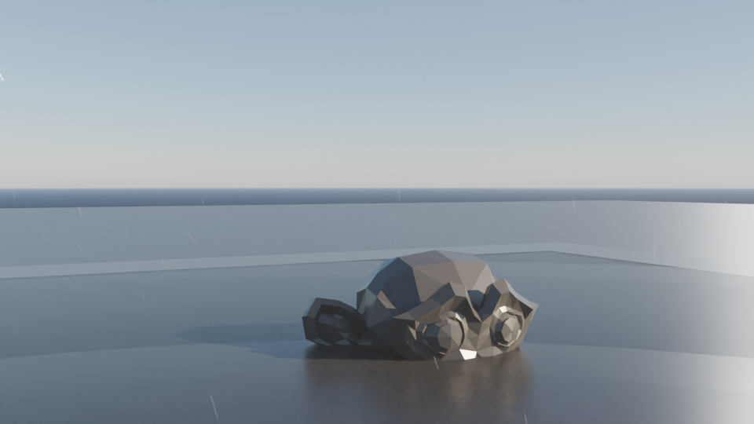
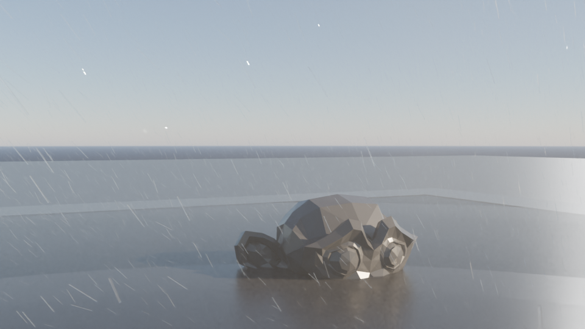
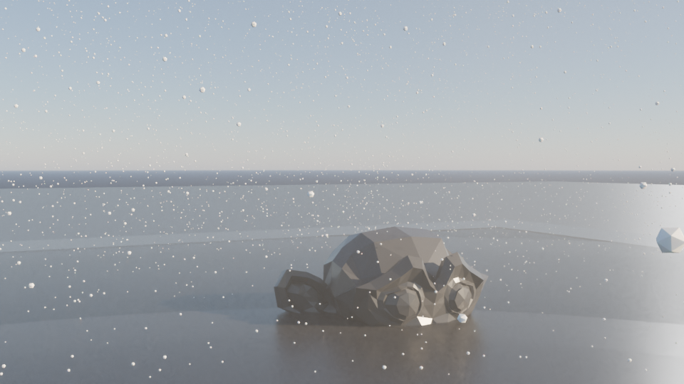

<h1>&nbsp;RainFX</h1>

**Physically based weather for Blender** — part of [OpenSimFX](https://github.com/opensimfx),
alongside BlastFX, FlowFX and AtmosFX.



| | |
|---|---|
|  |  |

_Renders: desktop Blender 5.2, Cycles, 64 samples (`tools/render_preview.py`). They are validation checks, not
showpieces._

RainFX brings physically based weather to Blender — dew, drizzle through downpour, wind-driven rain, thunderstorm, freezing rain, sleet, hail and snow. Drops are simulated with Geometry Nodes simulation zones and collide with your scene geometry through raycasts.

## Features

- **14 weather presets** — Dew through blizzard from `rainfx/data/presets.json` — extensible with your own user JSON files.
- **Real drop physics** — Marshall-Palmer size distribution, Gunn-Kinzer terminal velocity and drag relaxation toward the wind; hail and snow follow their own models.
- **Raycast collision** — Every particle step raycasts against the RainFX Colliders collection — no tunnelling through thin geometry.
- **Impact behaviour** — Splashes spawn ballistic droplets, hail and sleet bounce with restitution, snow sticks and recycles.
- **Wind with gusts** — Mean wind plus noise gusts in space and time; particles lag the air with relaxation time tau = v_t / g.
- **Atmosphere controls** — Fog volume (Volume Scatter), reversible sky and sun dimming, seeded lightning flashes; optional compositor glow chain never overwrites an existing setup.
- **Two engines, open output** — Geometry Nodes simulation zones plus a stock emitter engine with Collision modifiers; output as streaks, spheres or raw vertices for custom instancing.

## Install

Requires Blender **5.2.1** (target; supports Blender 5.0+).

```bash
python tools/build_extension.py        # -> dist/rainfx-0.2.0.zip
```

In Blender: *Edit > Preferences > Get Extensions > (v) > Install from Disk...*, pick the zip. The panel appears in the 3D Viewport sidebar (**N**) under **RainFX**.

For development, run Blender with the package folder symlinked into your extension repository, or use `blender --command extension build --source-dir rainfx`.

## Quick start

1. Model or open your scene (ground, buildings, props).
2. Select the objects that should stop rain, click **Add Selected as Colliders**.
3. Pick a preset, click **Add Weather Emitter** at the 3D cursor. Set the Volume (X, Y, height) to cover the camera view.
4. Start playback from the scene start frame. Rain needs roughly 2 s to fill the volume; start the timeline early or bake (RainFX panel → *Simulation → Bake*).
5. Render with EEVEE or Cycles. Streaks are already motion-blurred; disable renderer motion blur for the drops.

Full walkthrough: [docs/USER_GUIDE.md](docs/USER_GUIDE.md).

## Verification status (read this)

Verified in **headless Blender 5.0.1 (`bpy` wheel)**:

- Simulation passes physical assertions: no particle crosses the floor or a 2 m test cube, hail bounces, rain
  splashes, a control run without colliders fails the same check.
- Every preset runs, operators and live preset switching work.
- Fog, lightning keyframes, compositor and the particle-engine collision path work.

Verified in **desktop Blender 5.2.3 LTS, macOS arm64**:

- The built zip passes Blender's extension validator and installs, enables and adds a weather emitter in a clean
  profile; every panel draws and references only registered properties and operators.
- The README renders above come from `tools/render_preview.py` in this version.

**Not verified** - treat as unknown:

- The full simulation test suite inside Blender 5.2 (the physical assertions above ran on 5.0.1). The 5.2 modifier
  input path (`modifier.properties.inputs.<id>.value`) follows the official release notes and is covered by a logic
  test with a stand-in object.
- Blender versions other than 5.0.1 and 5.2.3; Windows; GPU Cycles; EEVEE on CI or a machine without a GPU/display.

Run `tests/blender_smoke.py` and `tests/blender_scene_smoke.py` inside your Blender first
([docs/DEVELOPMENT.md](docs/DEVELOPMENT.md)).

## Repository layout

```
rainfx/                 the add-on (this folder is what the extension zip contains)
  core/                 pure Python, no bpy: physics, presets, schema
  gn/                   Geometry Nodes builders: precipitation simulation, dew, materials
  scene/                emitters, colliders, atmosphere, lighting, compositor, particle engine
  ui/                   properties, operators, panels
  data/presets.json     the shipped preset library (generated)
  compat.py             every Blender-version-dependent API access
docs/                   user guide, presets, physics, system design, development, validation, references, roadmap, UI style
tests/                  pytest suites + headless Blender checks
tools/                  build_extension, gen_presets, gen_preset_docs, render_preview
```

## Develop

```bash
python -m pytest                          # pure tests, no Blender
python tests/blender_smoke.py             # needs bpy: simulation behaviour checks
python tests/blender_scene_smoke.py       # needs bpy: scene helpers
python tools/gen_presets.py               # regenerate data/presets.json from the table in the tool
python tools/gen_preset_docs.py           # regenerate docs/PRESETS.md
/Applications/Blender.app/Contents/MacOS/Blender -b --factory-startup \
    --python tools/render_preview.py -- light_rain docs/img/light_rain.png 64      # README renders
python tools/build_extension.py           # dist/rainfx-<version>.zip
```

See [docs/DEVELOPMENT.md](docs/DEVELOPMENT.md) and [CONTRIBUTING.md](CONTRIBUTING.md).

## Documentation

[User guide](docs/USER_GUIDE.md) · [Presets](docs/PRESETS.md) · [Physics](docs/PHYSICS.md) ·
[System design](docs/SYSTEM_DESIGN.md) · [Development](docs/DEVELOPMENT.md) · [Validation](docs/VALIDATION.md) ·
[References](docs/REFERENCES.md) · [Roadmap](docs/ROADMAP.md) · [UI style](docs/UI_STYLE.md) · [Changelog](CHANGELOG.md)

## License

GPL-3.0-or-later — see [LICENSE](LICENSE).
