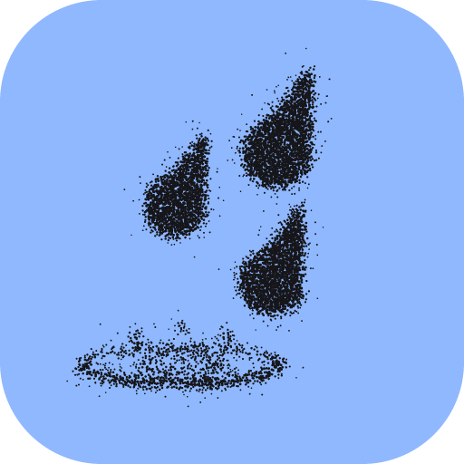
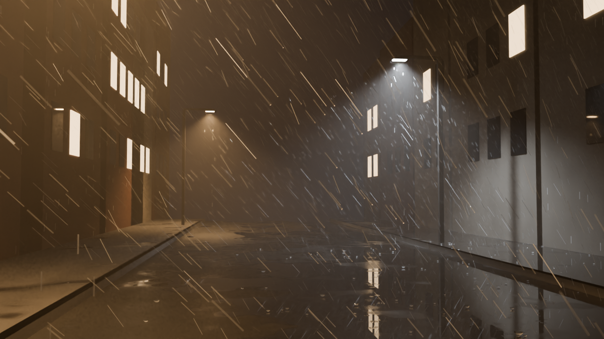
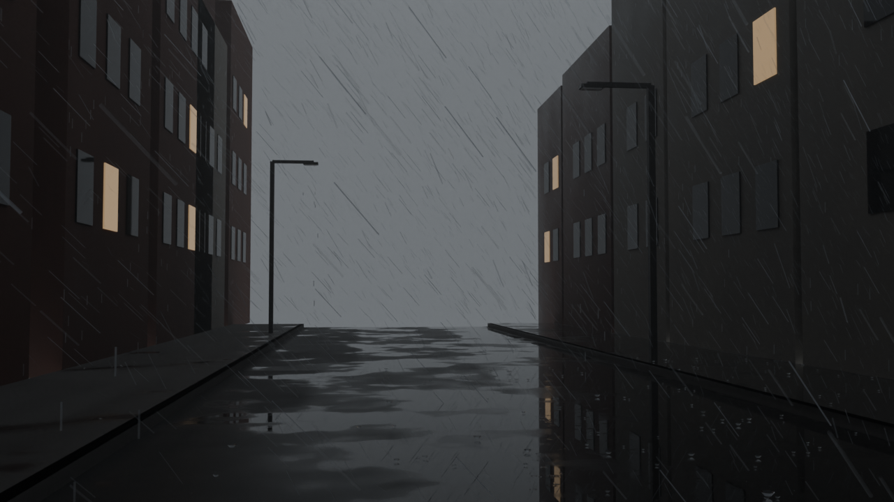
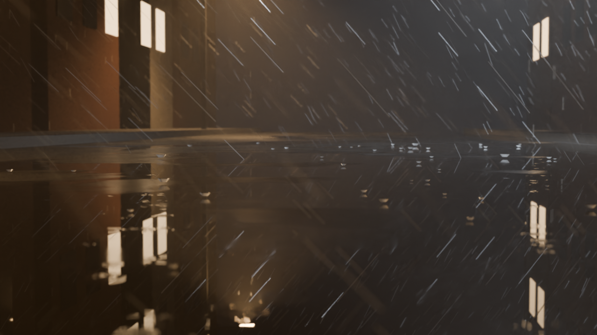
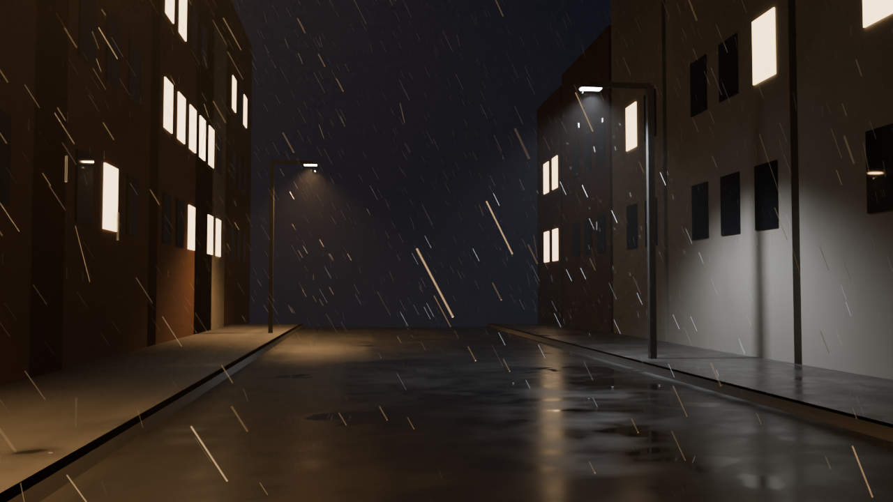
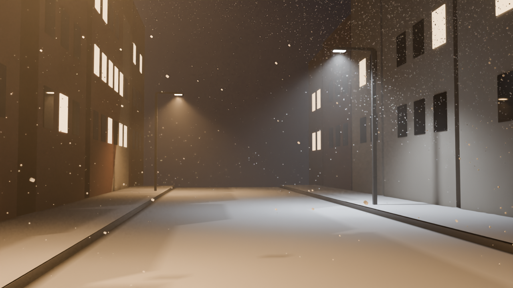
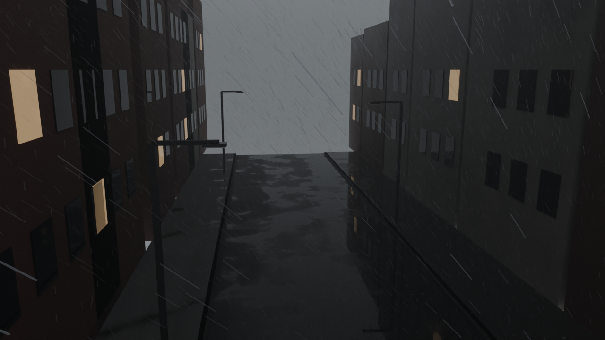

<h1>&nbsp;RainFX</h1>

**Physically based weather for Blender** — part of [OpenSimFX](https://github.com/opensimfx),
alongside BlastFX, FlowFX and AtmosFX.



| | |
|---|---|
|  |  |
|  |  |



_Renders: desktop Blender 5.2.3, Cycles, 128 samples, frame 48 (2 s in), straight from `tools/render_look.py`,
which builds the street from boxes and procedural materials and sets RainFX up the way a user would. No
compositing beyond RainFX's own glow._

RainFX brings physically based weather to Blender — dew, drizzle through downpour, wind-driven rain,
thunderstorm, freezing rain, sleet, hail and snow. Drops are simulated with Geometry Nodes simulation zones and
collide with your scene geometry through raycasts; the look follows how rain is actually seen and filmed.

## Features

- **14 weather presets** — Dew through blizzard from `rainfx/data/presets.json`, extensible with your own JSON.
- **Real drop physics** — Marshall-Palmer size distribution, Gunn-Kinzer terminal velocity and drag relaxation
  toward the wind; hail and snow follow their own models. Rain never starts under a roof.
- **Raycast collision** — Every step raycasts against the RainFX Colliders collection, moving colliders included.
- **Impacts** — Each drop splashes only when its own splashing parameter K = We Oh^-2/5 says so; crowns, spray
  mist, hail and sleet bounce, snow settles and builds up.
- **Rain that looks filmed** — Streaks are lit from behind like real drops (bright in front of a lamp, gone
  against the sky), true size near the camera, backlight helper, foreground layer, distant rain, lens drops,
  fog and glow that follow the rain rate.
- **Wet world** — Everything the rain can reach is wet, sheltered spots stay dry, puddles collect in low spots
  with ring ripples, wet asphalt streaks the lights; drips fall from roof edges, sills and lamp heads.
- **Atmosphere** — Fog volume with soft edges, reversible sky and sun dimming, seeded lightning, a compositor
  glow chain that never overwrites an existing setup.
- **Production workflow** — Background bakes, deterministic seeds, sound-ready impact events, and scenes from
  older versions upgrade in place.

## Install

Requires Blender **5.2 LTS**.

RainFX is sold on [Gumroad](https://arshth.gumroad.com/l/rainfx); GitHub releases no longer carry the zip.
The source here is GPL-3.0, so you can build it yourself:

```bash
python tools/build_extension.py        # -> dist/rainfx-1.0.0.zip
```

In Blender: *Edit > Preferences > Get Extensions > (v) > Install from Disk...*, pick the zip. The panel appears in the 3D Viewport sidebar (**N**) under **RainFX**.

For development, run Blender with the package folder symlinked into your extension repository, or use `blender --command extension build --source-dir rainfx`.

## Quick start

1. Model or open your scene (ground, buildings, props).
2. Select the objects that should stop rain, click **Add Selected as Colliders**.
3. Pick a preset, click **Add Weather Emitter** at the 3D cursor. Set the Volume (X, Y, height) to cover the camera view.
4. Turn on **Wetness** (Collisions) for wet ground and puddles, and **Distant Rain**, **Foreground Rain** and
   **Drips** for depth. At night, rain only shows where light is behind it: place lamps beyond the rain or use
   **Add Rain Backlight**.
5. Start playback from the scene start frame. Rain needs roughly 2 s to fill the volume; start the timeline early
   or bake (RainFX panel → *Simulation → Bake*).
6. Render with EEVEE or Cycles. Streaks are already motion-blurred; disable renderer motion blur for the drops.

Full walkthrough: [docs/USER_GUIDE.md](docs/USER_GUIDE.md).

## Verification status (read this)

Verified in **desktop Blender 5.2.3 LTS, macOS arm64** (20 Blender test scripts, 45 pure tests, all passing):

- Physics: no drop crosses the floor or a 2 m cube (a control run without colliders fails the same check), hail
  bounces, each drop's splash follows K, moving colliders throw their splashes, rain never starts under a roof
  or inside a closed shape, same seed gives the same rain, playback and bakes agree.
- Wetness and snow cover: exposed surfaces get wet (or snowy), ground under a roof stays dry, moved, rotated and
  scaled colliders get wet in the right place, several emitters feed it, it keeps working after reopening a
  file, and moving a collider updates the sheltering and drips by itself.
- Render farms: a baked scene opened in a Blender **without RainFX** and jumped straight to its last frame shows
  the same rain, wetness and drips (packed and background bakes).
- A scene saved by RainFX 0.3.0 opens, plays and upgrades in place without a crash; lens-drop maps survive saving.
- Background bakes contain the unsaved state of the scene and bake the chosen emitter; disabling the add-on
  mid-bake stops the child process.
- The built zip passes Blender's extension validator, installs, enables, adds an emitter and disables cleanly in
  a clean profile.
- Rendering: EEVEE in the tests, Cycles on the CPU and on the GPU (Metal) for the bench and the images above.
- Scale: 2,000 colliders with wetness and drips refresh in about 3 s and play at about 0.4 s per frame.

Also run on the **`bpy` 5.0.1 wheel** (simulation, wetness, hardening, drips, upgrade, scene and UI tests pass).
**CI** runs the pure tests on Linux, Windows and macOS; every non-EEVEE Blender test in Blender 5.2.3 and 5.2.4 on
Linux and the core ones in 5.2.3 on Windows (including the background bake with Windows paths and the farm test);
and renders the street bench in Cycles on both. Measurements are in [docs/VALIDATION.md](docs/VALIDATION.md).

**Not verified** - treat as unknown: interactive Windows and Linux sessions and NVIDIA/AMD GPUs (CI is headless),
and a real render-farm manager (the farm test does what a farm node does).

## Repository layout

```
rainfx/                 the add-on (this folder is what the extension zip contains)
  core/                 pure Python, no bpy: physics, presets, schema
  gn/                   Geometry Nodes builders: precipitation, wetness, drips, distant layer, dew, materials
  scene/                emitters, colliders, wetness, drips, atmosphere, lighting, compositor, baker
  ui/                   properties, operators, panels
  data/presets.json     the shipped preset library (generated)
  compat.py             every Blender-version-dependent API access
docs/                   user guide, presets, physics, system design, development, validation, references, roadmap, UI style
tests/                  pytest suites + headless Blender checks
tools/                  build_extension, gen_presets, gen_preset_docs, render_look, render_preview
```

## Develop

```bash
python -m pytest                          # pure tests, no Blender
BLENDER=/Applications/Blender.app/Contents/MacOS/Blender
$BLENDER -b --factory-startup --python-exit-code 1 --python tests/blender_smoke.py -- --control heavy_rain
$BLENDER -b --factory-startup --python-exit-code 1 --python tests/blender_wetness_smoke.py   # and the others
python tools/gen_presets.py               # regenerate data/presets.json from the table in the tool
python tools/gen_preset_docs.py           # regenerate docs/PRESETS.md
$BLENDER -b --factory-startup --python tools/render_look.py -- street_night heavy_rain \
    docs/img/street_night_heavy_rain.png 128 48                                   # README renders
python tools/build_extension.py           # dist/rainfx-<version>.zip
```

See [docs/DEVELOPMENT.md](docs/DEVELOPMENT.md).

## Documentation

[User guide](docs/USER_GUIDE.md) · [Presets](docs/PRESETS.md) · [Physics](docs/PHYSICS.md) ·
[System design](docs/SYSTEM_DESIGN.md) · [Development](docs/DEVELOPMENT.md) · [Validation](docs/VALIDATION.md) ·
[References](docs/REFERENCES.md) · [Roadmap](docs/ROADMAP.md) · [UI style](docs/UI_STYLE.md) · [Changelog](CHANGELOG.md)

## Contributions

This project does not accept contributions.

## License

GPL-3.0-or-later — see [LICENSE](LICENSE).
