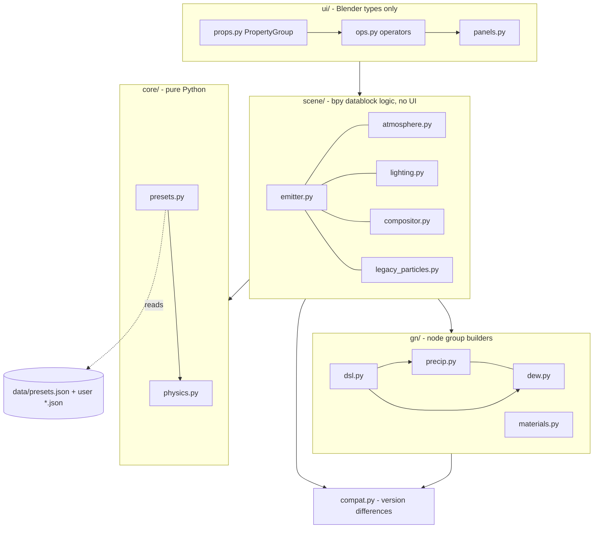
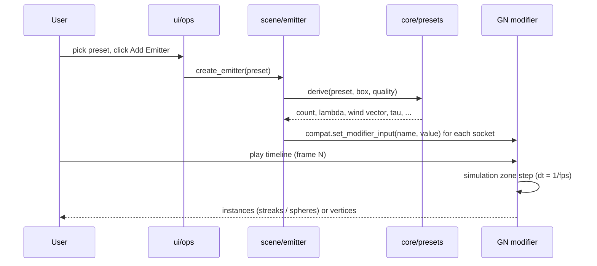

# System Design

Status: implemented for v0.1 unless a section says "planned". Every behavioural claim below is covered by a test in
`tests/` or marked as unverified.

## 1. Goals and non-goals

Goals

1. Physically grounded precipitation: drop size, fall speed, wind coupling and impact follow published relations.
2. Real collisions with arbitrary scene meshes, including thin surfaces, without per-object setup beyond membership in a collection.
3. One-click presets for the weather types in `PRESETS.md`, fully editable afterwards.
4. Uses Blender's built-in systems (Geometry Nodes simulation, Collision modifier, force fields, compositor, volumes) instead of private solvers.
5. Renders in EEVEE and Cycles; deterministic and bakeable.
6. Survives Blender API churn (4.2 to 5.2 changed the modifier input API, compositor, EEVEE ids, actions).

Non-goals (v0.1)

- Particle-particle collisions, drop coalescence, drag-based drop deformation.
- Real puddle geometry and expanding-ring ripples (shipped 0.2.0 as shading cues: pool mask, dark gloss + ripple bump; see ROADMAP.md phase 2 for the physical successors).
- Volumetric rain curtains for distant rain (phase 2).
- Fluid-grade splashes (Mantaflow hero mode, phase 3).

## 2. Architecture



Dependency rule: arrows only point downward. `core/` never imports `bpy`; this is what makes the physics and preset
logic testable with plain `pytest` (`tests/test_physics.py`, 11 tests) and keeps `rainfx/__init__.py` import-safe outside Blender.

### Component responsibilities

| Component | Responsibility |
|---|---|
| `core/physics.py` | Terminal velocity (rain, hail, snow), Marshall-Palmer slope and density, truncated-exponential sampler, relaxation time, wind vector, streak length |
| `core/presets.py` | `Preset` dataclass, validation, `derive()` (preset + volume + quality -> simulation inputs), JSON loading with user overrides |
| `gn/dsl.py` | Builder over `bpy` node trees. Looks sockets up by name among enabled sockets, never by identifier |
| `gn/precip.py` | Builds the `RainFX Precipitation` group: init, simulation zone, rendering instances |
| `gn/dew.py` | Builds the `RainFX Dew` group: beads on up-facing collider faces with a hard count cap |
| `gn/materials.py` | Water, splash, ice, snow, dew materials, created on demand; `wire_wetness()` links the wet look into a collider's material |
| `gn/wetness.py` | Builds the `RainFX Wetness` helper group: per-collider accumulation of `rainfx_wet` per face, `rainfx_pool` standing water mask, per-vertex `rainfx_snow` + post-sim normal lift |
| `gn/distant.py` | Builds the static `RainFX Distant` far layer group: seeded scatter, per-frame deterministic wrap drift, align-to-fall streak instancing (see 4.8) |
| `scene/distant.py` | Creates/updates/removes the background layer object, pushes preset-derived wind/fall speed, parents it to the Follow Object like the fog |
| `scene/wetness.py` | Attaches/removes the helper per collider and refreshes the hidden `RainFX Impacts` / `RainFX Snow Impacts` carriers each frame (see 4.6/4.7) |
| `scene/emitter.py` | Creates emitters, applies presets to modifiers, stores the applied wind on `rainfx_wind` for far-layer sync; `create_demo` seeds the demo ground plane + Suzanne colliders on the add operator (idempotent by name) |
| `scene/atmosphere.py` | Fog volume, reversible sky and sun scaling |
| `scene/lighting.py` | Seeded lightning schedule as constant-interpolated keyframes |
| `scene/compositor.py` | Glare chain if the scene has no compositor tree (never touches foreign trees); Lens Drops stage: two procedurally generated signed droplet maps drifted through a Displacement stage by frame drivers (see 4.9) |
| `scene/legacy_particles.py` | Alternative engine on Blender's emitter particle system |
| `scene/events.py` | Sound-ready export: replays the frame range, reads the impact sink ('imp' verts) each frame, writes JSON event log (see 4.10) |
| `compat.py` | All version-dependent API access |
| `ui/*` | Properties, operators, panels, preferences. No simulation logic |

## 3. Data flow



The preset to inputs mapping lives in exactly one function (`emitter.apply_preset`), so UI, tests and scripts cannot drift.

## 4. The simulation (Geometry Nodes)

### 4.1 State

All state is stored as named attributes on the point cloud inside the simulation zone. Anonymous attributes would be
dropped at the zone boundary (documented behaviour of simulation zones).

| Attribute | Type | Meaning |
|---|---|---|
| `position` | vector | metres; stored as world-space numbers inside the sim (base of the volume = Follow Object location + Follow Offset), converted back to emitter-local just before output |
| `velocity` | vector | m/s |
| `diameter` | float | mm (splash droplets store their own, smaller value) |
| `vt` | float | terminal fall speed, m/s |
| `tau` | float | relaxation time, s |
| `kind` | float | 0 primary particle, 1 splash droplet, 2 collider snapshot (rides in the state as a mesh component) |
| `bounces` | float | impacts survived (hail, pellets) |
| `age`, `life` | float | splash droplet age and lifetime, s |

### 4.2 Initialisation (frame 1, evaluated once)

1. Count = `Count x (Viewport Density if in viewport else 1)`.
2. Positions: uniform random in the box (X, Y centred, Z from 0 to height), then offset by the volume origin; a
   +Z/-Z ray-parity test against the colliders deletes any start point inside an enclosed volume (respawned
   points are not re-checked)
   (Follow Object's world location + Follow Offset; the emitter itself when no object is set).
3. Diameter: inverse-CDF sample of an exponential truncated to [D Min, D Max] with slope Lambda.
   `D = Dmin - ln(1 - u (1 - exp(-L (Dmax - Dmin)))) / L`. For rain, Lambda = 4.1 R^-0.21 (Marshall-Palmer).
4. Terminal speed by mode: rain (Stokes bridge below 0.5 mm, Atlas fit above), hail `0.85 x 9 (D/10)^0.8`, snow `v0 (0.85 + 0.03 D)`.
5. `tau = max(vt / g, 0.02) x Inertia`. Initial velocity = wind + (0, 0, -vt).

### 4.3 Per step

Collider velocities: the realised collider set itself rides inside the simulation state as a mesh
component (marked `kind = 2`). Each step it is matched against the previous copy with *Geometry
Proximity* (nearest point, independent of vertex order) and stores
`rainfx_velocity = (position - nearest previous) / dt` on itself — static geometry keeps exactly 0.
A raycast with a `FLOAT_VECTOR` attribute input then samples `rainfx_velocity` at the hit; that value
is `cvel`, scaled by the *Collider Push* socket (default 1). Bake-safe: no Python handlers, the
mechanism lives entirely inside the zone.

```text
split by kind -> primaries P0, splash S0

primaries (fields evaluated on P0, then frozen):
  gust     = (noise(pos / L + drift * t) - 0.5) * 2 * (1, 1, 0.6) * strength
  target   = wind + gust + (0, 0, -vt)
  v_new    = target + (v - target) * exp(-dt / tau)            # exact for any dt
  ray      = Raycast(collider snapshot, from pos, dir v_new, length |v_new| dt + radius)
  if hit:
      can_bounce = restitution > 0 and bounces < max_bounces
      bounce  -> pos = hit + n * 3 mm ; v = 0.85 v_rel_tangent - restitution v_rel_normal + cvel  (collider frame)
      else    -> recycle (+ splash spawn for rain)
  below floor without hit -> recycle
  recycle  -> new random position in the top 8 % of the box, v = wind + (0, 0, -vt)
  pos wraps horizontally inside the box (world-anchored around the Follow Object's position)

capture all results (Capture Attribute) -> Set Position / Store velocity / bounces
world->local: the final Set Position subtracts the emitter's world location, so the
output is emitter-local again (emitter rotation/scale must stay identity).

splash spawn: duplicate hit rain particles (Splash Amount copies)
  direction = normalize(0.6..1.4 n + tangential random), speed = Splash Speed x (0.4..1.6) x size factor + cvel
  life = random(min, max), diameter = parent x Splash Size x (0.4..1.2)

splash update: v += g dt ; pos += v dt ; age += dt ; delete where age > life
```

### 4.4 Output

Primaries become instances: cylinder (6 vertices) aligned to velocity and stretched to `|v| x Shutter`, or an ico
sphere when `Shutter = 0`. Width is `D x Visual Scale`. Splash droplets are ico spheres. `Output Mode = 1` outputs the raw
state as mesh vertices instead (used by the tests and useful for custom instancing). Primary drops that land this frame
also form an invisible vertex mesh inside the output (named `imp` flag = 1, zero area, renders nothing).

### 4.5 Why these choices (decision records)

| # | Decision | Alternatives rejected | Reason |
|---|---|---|---|
| D1 | Geometry Nodes simulation zone as main engine | Legacy particle system | Scales to 10^5 particles with BVH raycasts, bakeable, scriptable, drop-size distribution per particle. The legacy system is kept as a second engine |
| D2 | Raycast along each step | Collision modifier, proximity or distance checks | Exact for thin geometry at any speed (no tunnelling). Proximity checks miss fast particles |
| D3 | Recycle instead of spawn and delete | Emission rate with lifetime | Constant memory and cost, no emission bookkeeping, steady-state from frame 1 |
| D4 | Exponential velocity integrator | Explicit drag force | Unconditionally stable for any frame rate or sub-step; reproduces terminal velocity exactly |
| D5 | Capture Attribute before mutation | Set Position then re-read fields | Fields are lazy: after `Set Position` a field using `Position` returns the *new* position. Found while building; the freeze is mandatory |
| D6 | Wind as input vector plus noise | Blender Wind force field | The force field acts as a drag coupling toward the wind vector and removes vertical fall speed for horizontal wind (observed in `legacy_particles` testing). Not usable as drop-in wind |
| D7 | Presets as JSON, derived values computed in Python | Hard-coded node values | One source of truth for UI, docs (table is generated) and tests; users can add presets |
| D8 | `compat.py` is the only place that branches on version | Version checks scattered | The modifier input API changed in 5.2 and the compositor in 5.0 |
| D9 | Sockets looked up by name among enabled sockets | Identifier or index lookup | Compare and Random Value identifiers are type-suffixed and changed in 5.2 |
| D10 | Visual scale and streaks over physical drop size | True 0.5-5 mm drops | A 2 mm drop is sub-pixel at normal camera distances; streaks of length speed x shutter reproduce what a real camera records |
| D11 | Wetness via a hidden impact-carrier object | Helpers reading the emitter directly (pure GN), Dynamic Paint | ObjectInfo back to the emitter closes a dependency cycle the depsgraph breaks by serving empty geometry once two or more helpers read it (verified headless). DP cannot read GN instance geometry. The carrier costs one tiny frame_change handler; wet state stays in bake-safe helper sim zones |

### 4.6 Wetness (`RainFX Wetness` helper)

Each wet-enabled collider gets a `RainFX Wetness` node modifier at the top of its stack. It runs its own
simulation zone that accumulates a per-face `rainfx_wet` float: each step it finds how close the face
centre is to any current impact vertex, adds `Strength x exp(-distance / Wet Radius)`, and decays the
value by `Dry Rate x dt` (saturating at 1). The same step accumulates a per-face `rainfx_pool`
standing-water mask: the increment is footprinted on up-facing faces (`max(0, normal_z)`) and weighted
by a height mask over the object's own bounding box (low spots pool up to 65% stronger; the mask is a
weight, not a gate, so raised tops still pool at the 35% floor). Pools fill instantly inside the
footprint and dry 4x slower (`Dry Rate x dt x 0.25`), reading as lingering standing water.
`materials.wire_wetness()` links both attributes into the surface: Base Color pulled toward a dark
pool colour and roughness scaled by `1 - 0.85 x max(wet, pool)` — glossier, darker where wet (5.2's
Principled has no Wet Amount socket, so the cue is colour + roughness). Where `rainfx_pool` rises, the
material also gets a procedural ripple bump: noise texture over Object coordinates drifted along X by
a frame-driven time value (5.2's noise W socket is disabled), bump strength proportional to the pool
mask.

The impacts are not read from the emitter directly (D11): a hidden `RainFX Impacts` mesh object is
refreshed every frame by a `frame_change_post` handler that copies the emitter's evaluated impact
vertices; the helpers read that carrier via ObjectInfo. Wet *state* lives only in each helper's sim
zone, so baking is unaffected — the handler is just the input feed.

### 4.7 Snow cover (same helper, second carrier)

Snow lands come from a second hidden carrier: the emitter stores a named `snow` flag on landings
(pure arithmetic `1 - min(|mode - 2|, 1)` — Compare nodes evaluated stale inside this field
context in 5.2.1, verified by probe; group version forces a rebuild), and the handler routes
landings with the flag into `RainFX Snow Impacts` while plain rain hits keep going to
`RainFX Impacts`. The helper accumulates snow per vertex: per step it footprints flake proximity
by the same radius decay, gates on the *up-facing* factor `max(0, vertex normal_z)` (cube corners
keep a 0.577 share of the vertical normal) and adds `Snow Rate x dt` inside the footprint to
`saturated 1`. After the sim zone, a fresh Set Position lifts vertices along their normals by
`rainfx_snow x Snow Depth` — recomputed from the accumulated attribute every evaluation so the
sim state itself never receives displacement (no feedback, bake-safe).
`materials.wire_wetness()` stacks the snow look after the water cues: Base Color mixes toward
snow white by `rainfx_snow`, and roughness lifts by `+0.5 x snow` (clamped at 1) over the
wet-darkened value. Snow Rate and Snow Depth stay untouched by refresh (user tunables persist).
Note flake flux: light snow falls ~1 m/s, so a tall/sparse box takes a while before enough flakes
cross a raised face — the group version registry is precip 8 / wetness 3.

### 4.8 Distant rain (`RainFX Distant` far layer)

The near field is deliberately sparse (density ratio ~1%), so the far view needs filling. A
standalone `RainFX Distant` object carries a second, deliberately independent GN group — never
touching the emitter's eval mesh that the impact handler scans (`ObjectInfo`-back emitter still
owns its own object). The group is static: no simulation zone, no cache, no point state. The
`GeometryNodePoints` node's own position field freezes one seeded random spot per streak; the
motion is `(wind.xy, -vt) x scene seconds` wrapped through the box by a per-axis FRACTION of the
box span (FRACTION maps negatives upward, XY recentred afterwards), so every frame is a pure
function of frame time — replay, bake and live-edit safe by construction. Streaks align their Z
to the fall vector and lengthen with `vt x 0.12 x Streak Scale` like a time exposure (slow snow
presets read as short dots automatically). Instances are realized into the output so the
evaluated geometry equals what renders.

The scene side (`scene/distant.py`) mirrors the fog lifecycle: a display-bounds box object in
the RainFX collection, scaled to a 3x reach / max(2x height, 20 m) shelf, positioned at the
emitter and parented to the Follow Object exactly like `atmosphere.create_fog`. Inputs come
from the emitter's stored derived values — `wind` now persists as `obj["rainfx_wind"]` (the
mult-scaled wind tuple, previously lost to the scalar-only `rainfx_derived` store) and
`vt_mean_ms` from `rainfx_derived` — so far motion matches the simulation and re-syncs on every
Apply. `Count = 0.5 x Distant Density x far volume`. The `distant` material kind is a flat
translucent BLENDED streak with no transmission, keeping EEVEE cheap at thousands of instances.
Group version registry: precip 8 / wetness 3 / distant 1.

### 4.9 Lens interaction (compositor droplets)

The far layer fills the world; this item fills the glass. When Lens Drops is on, the RainFX
post tree (built by `create_post` if the scene has none — foreign trees are still never
touched) gets a Displacement stage inserted between Render Layers and Glare: two 128px
`float_buffer` RGBA maps generated at runtime carry droplets — mostly round beads, a quarter
stretched into drip streaks — encoded as signed displacement (`R` = dx, `G` = dy, amplitude
`4 x Lens Strength`, smooth `alpha` falloff) in an AlphaOver stack. Two Transform nodes drift
the maps downward (`frame x -0.35` and `frame x -0.85` frame drivers, `REPEAT` extension) so
streaks keep running down the glass in a non-repeating mix. Every inserted node is marked
`['rainfx_lens']`, so `remove_lens` can strip the stage and relink the bare chain; strengths
re-bake the maps in place (only when they change by more than 0.02) — drivers move pixels,
no per-frame Python.

Implementation guards learned the hard way in 5.2.1: generated images MUST be
`float_buffer=True` (byte images saturate the signed values >1 to 1.0 and clamp negatives to
0, which renders the stage as an exact no-op for many seeds), map size stays at 128px because
256px+ generated images sample black in the compositor, and `Image.update()` must never be
called on a generated buffer (it resets it). Transform units are pixels per frame; the drift
rates are feel-calibrated, not derived from wind (the stage is screen-space, deliberately
decoupled from world physics). Strength is capped at 3.0 so the stage reads as refraction,
not a broken image.

(The GN group-version registry does not change: precip 8 / wetness 3 / distant 1 — no
Geometry Nodes in this stage.)

### 4.10 Sound-ready impact events

`scene/events.py::export_events` turns the sim into a replayed event log for audio
middleware. It reuses the impact sink that already rides the emitter output — every landed
drop each frame exists as a real vertex flagged `imp > 0.5` in the emitter's evaluated mesh
(the same stream the wetness handler reads) — so there is no new node group and no cache:
for each frame in the range, the depsgraph is stepped, the sink verts are read
(`imp` → presence, `snow` → 'snow' vs 'impact' type, `diameter` → intensity in mm; up to
256 per frame via even-stride sampling) and the frame's events joined below. Positions are
emitter-local (consumers multiply by the emitter's `matrix_world` when the layer is
follow-mounted). The operator `rainfx.export_events` (Collision panel button, *Export
Impact Events*) applies this to the active emitter and writes
`{"version": 1, "fps", "frame_start", "frame_end", "preset", "vt_mean_ms", "sample_stride",
"events": [...]}` — default path `<user presets>/rainfx_impact_events.json`, with a *File
Path* property for a custom target. Headless emitters reset their spawn points at the
viewport residence multiplier, so the exporter pushes `Viewport Density` to 1.0 for the
walk and restores the user's value afterwards; the stride is `ceil(hits / cap)` to
guarantee the cap. The replay is the deterministic per-frame sim stepping, so an export
matches bake playback and every rerun. Rain/snow landings stay separated so middleware can
map flake impacts to softer sound layers.

(Registry unchanged — no Geometry Nodes; the push/restore on `Viewport Density` is the
only socket traffic.)

## 5. Rain density: physical vs simulated

Marshall-Palmer gives about 3,000 drops per m3 at 10 mm/h, so a 16 x 16 x 10 m volume would hold roughly 8 million drops.
v0.1 simulates 0.3-1.3 % of that and compensates with streak length and `Visual Scale`. The Derived Physics panel shows the ratio.
A multi-layer approach (dense near field, screen-space or volumetric far field) is phase 2.

## 6. Performance

Measured in a 1-CPU sandbox with Blender 5.0.1 headless (instancing included, single sphere/cylinder instance per point):

| Particles | ms per frame |
|---|---|
| 19,200 | 33 |
| 76,800 | 116 |
| 122,880 | 189 |

Cost is close to linear in particle count (about 1.5 microseconds per particle-step on that machine, raycast included for a
two-object collider set). Expect much better numbers on multi-core hardware, but collider triangle count raises raycast cost
(BVH built each step from `Collection Info` + `Realize Instances`). Mitigations: keep colliders to proxy meshes, use
`Viewport Density` (default 0.3), bake before rendering.

## 7. Caching and determinism

- Simulation caches follow Blender's standard bake workflow; the RainFX panel exposes *Bake* (scene frame range,
  disk or packed target) and *Delete* (`rainfx.bake` / `bake_delete` wrap `simulation_nodes_cache_bake/delete`).
- Baked frames replay exactly when the bake starts at the scene start frame (verified: disk and packed, partial
  ranges covered-exactly); continuing past the baked end is not identity-stable in Blender 5.2.1, so re-bake when
  the render range grows.
- *Background bake* (0.2.0): bpy is main-thread-only and the stock bake op is one blocking call, so a true
  "different thread" is a second headless Blender process (`rainfx/scene/baker.py`) opened on the saved .blend.
  The parent pre-sets the bake metadata (range, `bake_target='DISK'`, `bake_directory`), which persists through
  the save, and the child re-applies it and runs the stock bake op. Progress is the number of per-frame cache
  files (`<bake_dir>/<record-id>/blobs/*.blob`) against the expected count — polled by a 0.5 s `bpy.app.timers`
  tick that also sets a WAIT cursor. Packed bakes keep the legacy in-process path bit-for-bit.
- Random streams are seeded from `Seed` and the scene frame, so the same file is expected to give the same weather (not covered by a test yet).
- Changing Count, box size or most inputs requires a re-bake or playing again from the start frame, as with any simulation zone.

## 8. Error handling and robustness

- `compat.set_modifier_input` returns `False` instead of raising when a socket does not exist, so presets with extra keys never break an older node group.
- Node groups carry `rainfx_version`; `ensure_group()` rebuilds a stale group rather than editing it.
- A broken user preset file is skipped with a console message.
- The compositor is untouched when the scene already has nodes; lighting changes store the original values and can be reverted.
- Dew has a hard bead cap (`Max Beads`) derived from collider area. Without it a 120 m ground plane produced 5 million beads in testing.

## 9. Known limitations (v0.2)

1. Collider velocities are translation-only: matched step-over-step by nearest point, so rotating or deforming colliders get approximate velocities, and changing the collider set mid-simulation costs one inaccurate step.
2. Only init positions get the inside-collider test; a recycled (respawned) drop can still start inside a collider for one follow-up scan of the box. Open-topped shapes (cups) are not detected by the ray parity.
3. One impact per particle per step; with default 24 fps and speeds under 15 m/s this is not visible.
4. Puddles are an amber cue (colour + roughness + ripple bump), not real water: no geometry, no refraction, no growing ring waves.
5. Snow lift is per vertex on the receiving face's own normals, so low-res meshes lift as plates and seams can open where normals differ; there is no melt or settling physics.
6. The distant layer is a wrapping open-world filler: it never collides, splashes or gates on camera distance, and its shelf edge is visible if a wide shot puts the camera outside it (turn the layer off or enlarge the Volume).
7. The lens stage is screen-space: droplet drift is calibrated by feel (pixels per frame, decoupled from wind), and a droplet warps whatever the camera sees — it has no notion of what is behind the glass, so very bright highlights can smear unrealistically. The stage also assumes an unclipped camera framing.
8. Impact-event exports sample the impact sink with a per-frame cap of 256 (even stride), so dense storms are a statistical sample, not a lossless record; 'intensity' is only the landing drop's diameter (no per-event velocity), and positions are emitter-local — consumers multiply by the emitter's `matrix_world` when the layer is follow-mounted. The export replays the whole frame range sequentially, so cost grows linearly with range and collision complexity.
9. Blender 5.2.1 runtime behaviour is unverified (see Testing).


---

## Testing


### 1. Layers

| Layer | Files | Needs Blender | What it proves |
|---|---|---|---|
| Unit | `tests/test_physics.py`, `tests/test_presets.py` | no | Formulas match reference values; presets validate; derived numbers are physical; user presets override and broken files are skipped |
| Simulation behaviour | `tests/blender_smoke.py` | yes (`bpy`) | The Geometry Nodes simulation obeys physics: no particle ends below the floor, none inside a collider, hail bounces, rain splashes, speeds plausible |
| Follow Object | `tests/blender_follow_smoke.py` | yes (`bpy`) | The volume relocates with the follow target during movement (spawn, wrap, recycle stay inside the moving box), fixed mode keeps emitter-local output |
| Moving colliders | `tests/blender_motion_smoke.py` | yes (`bpy`) | Splashes from a moving cube carry the cube's velocity (both run share and mean speed checked); push-off control run stays slow |
| Inside-collider starts | `tests/blender_inside_smoke.py` | yes (`bpy`) | Start points inside a closed room are rejected at init (~5% of the volume rejected, zero primaries inside the cavity from the first frame) |
| Bake workflow | `tests/blender_bake_smoke.py` | yes (`bpy`) | Disk bake (scene range) and packed bake replay covered frames exactly; delete clears disk blobs and restores live playback |
| Background bake | `tests/blender_bake_bg_smoke.py` | yes (`bpy`) | `baker.launch` spawns a second headless Blender on the saved .blend that bakes the disk cache itself; the parent polls the per-frame `.blob` files (progress = blobs written vs expected, monotonic); double-launch is refused while one runs; parent playback after the child bake matches the live sim exactly (max delta 0); `finish` reaps the process and clears the module state; `bake_delete` resets. Facts: child must be spawned with `sys.argv[0]` (Blender binary — `sys.executable` is the bundled python), the child script is a real file (`--python-expr` can't take multiline code), `$BAKE_DIR` substitution must be quoted, and blob layout is `<bake_dir>/<record-id>/blobs/{frame:05d}_00000.blob` |
| Wetness | `tests/blender_wetness_smoke.py` | yes (`bpy`) | Helpers attach to every collider; dry before rain, hit faces saturate >0.3, far faces stay <=0.05; pools fill on flat up-facing faces (ground/cube top) while vertical walls stay near-zero; toggle-off removes helpers; wet+pool+snow material wiring idempotent with ripple bump and frame driver (hidden "RainFX Impacts" carrier feeds helpers; carrier refresh runs inside frame_change_post). Snow sub-scene: light_snow world (compact 4x4x3 box for flake flux; Snow Rate 1.0 pushed on both helpers; walk limited to scene frame_end because sim zones stop stepping past it) — cube top accumulates rainfx_snow >0.2 and lifts z 2.0 -> 2.0156, rain worlds stay snow-inert (zmax 2.0) |
| Distant rain | `tests/blender_distant_smoke.py` | yes (`bpy`) | The far layer builds with preset-synced inputs (Box/Count/Wind/Fall Speed/Seed/Material); streaks realize into real verts and stay inside the inflated far shelf across a full fall cycle (frames 1/60/120); same-frame re-eval is bit-identical (pure frame function, no cache); the emitter's eval mesh (impact scan) is unchanged with the layer on vs off over a 124-frame walk; follow parenting tracks a mover; toggle-off is idempotent; headless EEVEE frame renders. (Headless emitter inspection needs the `Viewport Density` / `Output Mode` pushes, mirroring blender_smoke.py) |
| Lens interaction | `tests/blender_lens_smoke.py` | yes (`bpy`) | apply_lens builds the marked droplet stage (6 nodes, both Transform drivers evaluate when the frame is set); second call adds nothing; a foreign unmarked compositing tree is returned untouched; strength rebake bakes mapped values idempotently; remove_lens restores the bare chain and drops the maps; headless EEVEE 64px A/B render (compositing on vs off) shows a visible warp (mean diff ≫ noise floor) and frames 10 vs 26 differ (drift is live). Generated maps must be `float_buffer=True` — byte images saturate the signed displacement to a no-op; map size stays at 128px because ≥256px generated images sample black in the 5.2 compositor |
| Materials | `tests/blender_material_smoke.py` | yes (`bpy`) | Every material builds with sane alpha/transmission; *Refraction Drops* swaps only water presets to the drop variant; headless EEVEE frame renders |
| Sound-ready events | `tests/blender_events_smoke.py` | yes (`bpy`) | export_events replays a heavy_rain world for 24 frames and writes a JSON with sane metadata and thousands of events (frames in range, positions on the ground/cube top, intensities = drop diameters > 0, types impact/snow); no frame ever exceeds the per-frame cap of 256 (odd strides ceil–rounded); a pushed Viewport Density value is restored after the walk; light_snow exports strictly snow-typed events (97-frame world); a collider-less drizzle world exports a valid empty log. (Headless emitters need the `Viewport Density` push, which the exporter does itself and restores) |
| Determinism | `tests/blender_determinism_smoke.py` | yes (`bpy`) | Twin emitters with the same seed are bit-identical every frame; scrub replay and forced re-sim match exactly; a changed Seed moves only the changed emitter (input changes need a cache delete to dirty the sim) |
| Scene helpers | `tests/blender_scene_smoke.py` | yes | Fog and lighting scale and revert, lightning keyframes fire, compositor is not overwritten, dew is capped, the particle engine collides and kills, the 5.2 input-path branch logic |
| UI | `tests/blender_ui_smoke.py` | yes | Register / unregister, operators, live preset switching, diagnostics; the [Demo] block asserts add_emitter seeds the demo plane + Suzanne into the collider set (idempotent on re-run), and the icon-enum guard scans every `icon="..."` literal in `rainfx/ui/*.py` against the real `UILayout` enum (regression for the MOD_SMOKE icon removed in 5.2) |

#### Anti-vacuous-pass design

A collision test that passes because nothing ever reaches the collider proves nothing. `blender_smoke.py --control` runs the
same scene with the colliders removed and requires the *same* check to fail (particles found inside the cube). Measured:
32-47 particles inside the 2 m cube without colliders, 0 with colliders.

### 2. Running

Plain tests (any Python 3.10+):

```bash
python -m pytest            # 21 tests
```

Blender tests with the PyPI `bpy` wheel (Python 3.11 for bpy 5.0.x; 5.2 wheels need the Python version that release specifies):

```bash
python tests/blender_smoke.py --control heavy_rain hailstorm light_snow
python tests/blender_scene_smoke.py
python tests/blender_ui_smoke.py
```

Inside an installed Blender (recommended for 5.2.1; Blender bundles numpy):

```bash
blender -b --factory-startup --python tests/blender_smoke.py -- --control heavy_rain hailstorm
blender -b --factory-startup --python tests/blender_scene_smoke.py
blender -b --factory-startup --python tests/blender_ui_smoke.py
```

### 3. Results recorded while building (Blender 5.0.1 headless, 1 CPU)

| Test | Result |
|---|---|
| Plain pytest | 21 passed |
| Simulation, all 13 simulated presets (drizzle, light, moderate, heavy, downpour, wind-driven, thunderstorm, freezing rain, sleet, hailstorm, light snow, heavy snow, blizzard) | passed: 0 below floor, 0 inside the cube at frame 90, splashes for splashing presets, hail and sleet bounced |
| Control run (no colliders) | passed: found 32-47 particles inside the cube |
| Scene helpers (7 tests) | passed; dew limited to 199,723 beads by the cap; particle engine: 192 born, 74 alive at frame 100 (the rest killed by colliders), none below the floor |
| UI smoke | passed: register, add emitter, live switch thunderstorm to hailstorm to dew to heavy snow, diagnostics, legacy emitter, compositor, revert lighting; **[Demo]**: the add op seeds a 4-vert *RainFX Surface* plane + a Suzanne (>100 verts in 5.2.1) into the colliders collection at the origin and is idempotent on re-run; **icon guard**: every `icon="..."` literal in `rainfx/ui/*.py` is asserted against the real `UILayout` enum (regression for MOD_SMOKE, removed in Blender 5.2) |
| Bake operator | returns FINISHED on a saved file; the resulting cache contents were not independently inspected |
| Performance | 19,200 particles 33 ms/frame, 76,800 116 ms, 122,880 189 ms |

Mean speeds measured (heavy rain 5.5 m/s = sqrt(3.85^2 + 4^2) as predicted by terminal speed plus wind) match the derived values.

### 4. Not verified

| Item | Why | How to close |
|---|---|---|
| Blender 5.2.1 runtime | No 5.2 build or wheel was available. Everything above ran on 5.0.1 | Run the three Blender test scripts in 5.2.1 (section 5) |
| 5.2 modifier input path | Only logic-tested with a stand-in object | `blender_ui_smoke.py` exercises it for real in 5.2; `Run Diagnostics` shows which path is active |
| Rendered appearance | No render was performed; EEVEE and Cycles materials are untuned | Render a test frame (section 5, step 6) |
| Extension manifest | Blender's validator was not available | `blender --command extension validate dist/rainfx-0.1.0.zip` |
| Cache contents after Bake | Operator run only | Bake, save, reopen, scrub |
| Animated colliders, determinism across sessions | Not covered | Add tests before relying on them |
| Gunn-Kinzer reference values in `test_physics.py` | Entered from memory of the published table (4.03, 6.49, 8.06, 8.83, 9.09 m/s) and not re-read from a fetched source | Compare with the original table |
| Interactive UI (drawing, redraw, undo) | Headless cannot draw panels | Open the sidebar and click through |
| Multiple emitters, huge colliders | Not tested | Manual |

### 5. Acceptance checklist for Blender 5.2.1

1. Install the zip (`python tools/build_extension.py`), enable it, confirm the RainFX tab appears.
2. Run the three scripts above inside 5.2.1; all must print PASS.
3. Open a scene with a ground plane and a roof; add both as colliders; add Heavy Rain; play from frame 1; confirm nothing falls through the roof and that the space under it stays dry.
4. Click *Run Diagnostics*; it must report "GN modifier API: properties.inputs (5.2+)" and "Group sockets OK".
5. Switch through Hailstorm (bounces), Light Snow, Dew, Thunderstorm (flashes) with Live Update on.
6. Render frame 60 with EEVEE and with Cycles at low samples; check streak visibility with a back light.
7. Save, bake, reopen, scrub the timeline; compare frame 60 before and after reopening.
8. Disable and remove the extension; purge orphans; confirm no errors in the console.

### 6. Adding tests

- Anything in `core/` gets a plain pytest test with a reference value and a source in the docstring.
- Anything touching `bpy` goes into one of the three Blender scripts. Prefer asserting physical outcomes (positions, counts, speeds) over "ran without error".
- When a check could pass vacuously, add a control run that must fail.


---

## Project Structure


```text
rainfx_project/
├── README.md
├── LICENSE                         GPL-3.0-or-later
├── CHANGELOG.md
├── pyproject.toml                  pytest configuration
├── docs/
│   ├── SYSTEM_DESIGN.md            architecture, algorithm, decisions
│   ├── PHYSICS.md                  models and sources
│   ├── PRESETS.md                  GENERATED table + schema
│   ├── USER_GUIDE.md
│   └── ROADMAP.md
├── rainfx/                         the extension (this folder is what gets zipped)
│   ├── blender_manifest.toml       extension metadata (schema 1.0.0)
│   ├── __init__.py                 register() / unregister(); no top-level bpy import
│   ├── compat.py                   ALL version-dependent API access
│   ├── core/                       pure Python, never imports bpy
│   │   ├── physics.py
│   │   └── presets.py
│   ├── gn/                         node group builders
│   │   ├── dsl.py
│   │   ├── precip.py               rain, hail, snow simulation group
│   │   ├── dew.py
│   │   └── materials.py
│   ├── scene/                      datablock logic, no UI
│   │   ├── emitter.py              emitters, colliders, preset application
│   │   ├── atmosphere.py
│   │   ├── lighting.py
│   │   ├── compositor.py
│   │   └── legacy_particles.py
│   ├── ui/
│   │   ├── props.py
│   │   ├── ops.py
│   │   └── panels.py               also AddonPreferences
│   └── data/
│       └── presets.json            GENERATED by tools/gen_presets.py
├── tests/
│   ├── test_physics.py             plain pytest (no Blender)
│   ├── test_presets.py             plain pytest (no Blender)
│   ├── blender_smoke.py            simulation behaviour (needs bpy)
│   ├── blender_scene_smoke.py      scene helpers (needs bpy)
│   └── blender_ui_smoke.py         registration and operators (needs bpy)
└── tools/
    ├── gen_presets.py              preset table -> data/presets.json
    ├── gen_preset_docs.py          presets + physics -> docs/PRESETS.md
    └── build_extension.py          rainfx/ -> dist/rainfx-<version>.zip
```

### Dependency rules

| Layer | May import | Must not import |
|---|---|---|
| `core` | stdlib | `bpy`, anything above |
| `compat` | `bpy` | `core`, `scene`, `ui` |
| `gn` | `bpy`, `compat`, `core` | `scene`, `ui` |
| `scene` | `bpy`, `gn`, `core`, `compat` | `ui` |
| `ui` | everything | none |

`rainfx/__init__.py` must stay free of top-level `bpy` imports so `tests/test_physics.py` and the generator tools run in a plain interpreter. This was broken once during development (the package init imported `compat`) and is now guarded by the plain-pytest run.

### Naming conventions

- Operators: `rainfx.<verb>` ids, classes `RAINFX_OT_*`; panels `RAINFX_PT_*`.
- Node groups: `RainFX <Name>`; custom property `rainfx_version` on the group.
- Datablocks created by the add-on start with `RainFX ` so users can find and purge them.
- Emitter objects carry the custom property `rainfx_emitter = True` plus `rainfx_preset` and `rainfx_derived`.
- Collections: `RainFX` (everything created) and `RainFX Colliders` (what rain hits).

### Node group interface (precipitation)

Panels and sockets in `gn/precip.py`. The Python side addresses sockets by name through `compat.set_modifier_input`, so
renaming a socket requires updating `emitter.apply_preset` and `docs/PRESETS.md`.

| Panel | Sockets |
|---|---|
| Setup | Colliders, Mode, Seed, Box Size, Count, Viewport Density, Output Mode |
| Population | D Min, D Max, Lambda, Speed Scale, Snow Speed |
| Air | Wind, Gust Strength, Gust Scale, Gust Speed, Inertia |
| Impact | Restitution, Max Bounces, Splash Amount, Splash Speed, Splash Life Min, Splash Life Max, Splash Size, Gravity |
| Look | Shutter, Visual Scale, Drop Material, Splash Material |

### Build and release

```bash
python tools/gen_presets.py          # only after editing the preset table
python tools/gen_preset_docs.py      # regenerates docs/PRESETS.md
python -m pytest tests               # plain tests
python tests/blender_smoke.py        # with a bpy-capable interpreter, see Testing
python tools/build_extension.py      # dist/rainfx-<version>.zip
blender --command extension validate dist/rainfx-<version>.zip
```

Version bump: edit `version` in `rainfx/blender_manifest.toml`, add a `CHANGELOG.md` entry, rebuild. Bump
`GROUP_VERSION` in `gn/precip.py` or `gn/dew.py` whenever the node graph changes so existing files rebuild the group.

### Adding things

| Task | Where |
|---|---|
| New preset | Add to the table in `tools/gen_presets.py`, run both generators |
| New weather mode | `core/presets.py` (`MODES`, `derive`), `gn/precip.py` (Mode switch), tests |
| New node group input | `gn/precip.py` interface + graph, `emitter.apply_preset`, bump `GROUP_VERSION`, update the table above |
| New Blender-version workaround | `compat.py` only, with a comment naming the release note |
