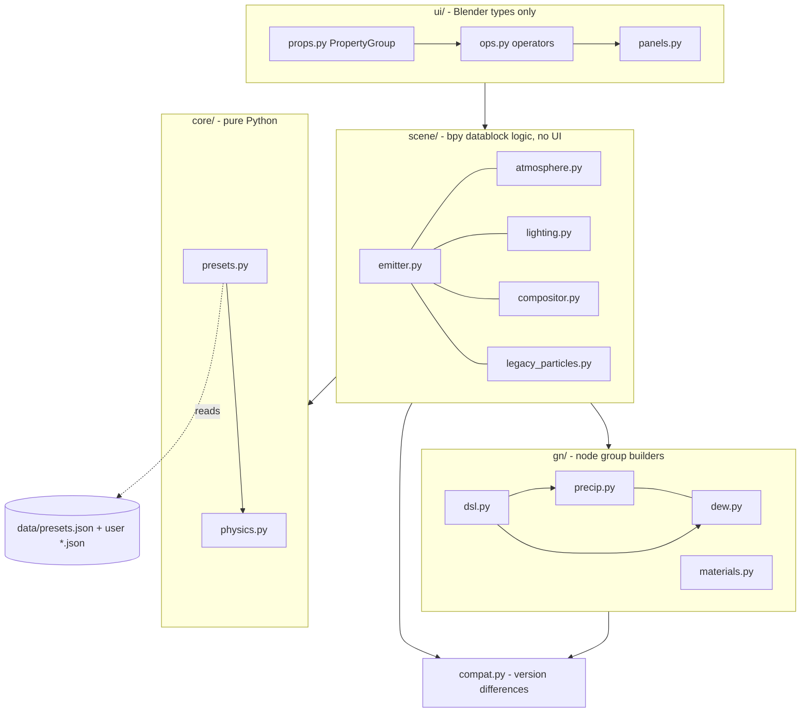
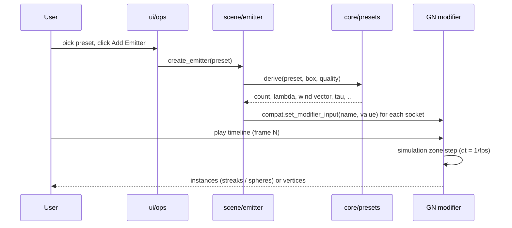

# System Design

Status: implemented for v0.1 unless a section says "planned". Every behavioural claim below is covered by a test in
`tests/` or marked as unverified.

## 1. Goals and non-goals

Goals

1. Physically grounded precipitation: drop size, fall speed, wind coupling and impact follow published relations.
2. Real collisions with arbitrary scene meshes, including thin surfaces, without per-object setup beyond membership in a collection.
3. One-click presets for the weather types in `PRESETS.md`, fully editable afterwards.
4. Uses Blender's built-in systems (Geometry Nodes simulation, Collision modifier, force fields, compositor, volumes) instead of private solvers.
5. Renders in EEVEE and Cycles; deterministic and bakeable.
6. Survives Blender API churn (4.2 to 5.2 changed the modifier input API, compositor, EEVEE ids, actions).

Non-goals (v0.1)

- Particle-particle collisions, drop coalescence, drag-based drop deformation.
- Surface wetness, puddles and ripples (planned, `ROADMAP.md` phase 2).
- Volumetric rain curtains for distant rain (phase 2).
- Fluid-grade splashes (Mantaflow hero mode, phase 3).

## 2. Architecture



Dependency rule: arrows only point downward. `core/` never imports `bpy`; this is what makes the physics and preset
logic testable with plain `pytest` (`tests/test_physics.py`, 11 tests) and keeps `rainfx/__init__.py` import-safe outside Blender.

### Component responsibilities

| Component | Responsibility |
|---|---|
| `core/physics.py` | Terminal velocity (rain, hail, snow), Marshall-Palmer slope and density, truncated-exponential sampler, relaxation time, wind vector, streak length |
| `core/presets.py` | `Preset` dataclass, validation, `derive()` (preset + volume + quality -> simulation inputs), JSON loading with user overrides |
| `gn/dsl.py` | Builder over `bpy` node trees. Looks sockets up by name among enabled sockets, never by identifier |
| `gn/precip.py` | Builds the `RainFX Precipitation` group: init, simulation zone, rendering instances |
| `gn/dew.py` | Builds the `RainFX Dew` group: beads on up-facing collider faces with a hard count cap |
| `gn/materials.py` | Water, splash, ice, snow, dew materials, created on demand |
| `scene/emitter.py` | Creates emitters, applies presets to modifiers, manages the colliders collection |
| `scene/atmosphere.py` | Fog volume, reversible sky and sun scaling |
| `scene/lighting.py` | Seeded lightning schedule as constant-interpolated keyframes |
| `scene/compositor.py` | Glow chain only if the scene has no compositor nodes |
| `scene/legacy_particles.py` | Alternative engine on Blender's emitter particle system |
| `compat.py` | All version-dependent API access |
| `ui/*` | Properties, operators, panels, preferences. No simulation logic |

## 3. Data flow



The preset to inputs mapping lives in exactly one function (`emitter.apply_preset`), so UI, tests and scripts cannot drift.

## 4. The simulation (Geometry Nodes)

### 4.1 State

All state is stored as named attributes on the point cloud inside the simulation zone. Anonymous attributes would be
dropped at the zone boundary (documented behaviour of simulation zones).

| Attribute | Type | Meaning |
|---|---|---|
| `position` | vector | metres; stored as world-space numbers inside the sim (base of the volume = Follow Object location + Follow Offset), converted back to emitter-local just before output |
| `velocity` | vector | m/s |
| `diameter` | float | mm (splash droplets store their own, smaller value) |
| `vt` | float | terminal fall speed, m/s |
| `tau` | float | relaxation time, s |
| `kind` | float | 0 primary particle, 1 splash droplet, 2 collider snapshot (rides in the state as a mesh component) |
| `bounces` | float | impacts survived (hail, pellets) |
| `age`, `life` | float | splash droplet age and lifetime, s |

### 4.2 Initialisation (frame 1, evaluated once)

1. Count = `Count x (Viewport Density if in viewport else 1)`.
2. Positions: uniform random in the box (X, Y centred, Z from 0 to height), then offset by the volume origin
   (Follow Object's world location + Follow Offset; the emitter itself when no object is set).
3. Diameter: inverse-CDF sample of an exponential truncated to [D Min, D Max] with slope Lambda.
   `D = Dmin - ln(1 - u (1 - exp(-L (Dmax - Dmin)))) / L`. For rain, Lambda = 4.1 R^-0.21 (Marshall-Palmer).
4. Terminal speed by mode: rain (Stokes bridge below 0.5 mm, Atlas fit above), hail `0.85 x 9 (D/10)^0.8`, snow `v0 (0.85 + 0.03 D)`.
5. `tau = max(vt / g, 0.02) x Inertia`. Initial velocity = wind + (0, 0, -vt).

### 4.3 Per step

Collider velocities: the realised collider set itself rides inside the simulation state as a mesh
component (marked `kind = 2`). Each step it is matched against the previous copy with *Geometry
Proximity* (nearest point, independent of vertex order) and stores
`rainfx_velocity = (position - nearest previous) / dt` on itself — static geometry keeps exactly 0.
A raycast with a `FLOAT_VECTOR` attribute input then samples `rainfx_velocity` at the hit; that value
is `cvel`, scaled by the *Collider Push* socket (default 1). Bake-safe: no Python handlers, the
mechanism lives entirely inside the zone.

```text
split by kind -> primaries P0, splash S0

primaries (fields evaluated on P0, then frozen):
  gust     = (noise(pos / L + drift * t) - 0.5) * 2 * (1, 1, 0.6) * strength
  target   = wind + gust + (0, 0, -vt)
  v_new    = target + (v - target) * exp(-dt / tau)            # exact for any dt
  ray      = Raycast(collider snapshot, from pos, dir v_new, length |v_new| dt + radius)
  if hit:
      can_bounce = restitution > 0 and bounces < max_bounces
      bounce  -> pos = hit + n * 3 mm ; v = 0.85 v_rel_tangent - restitution v_rel_normal + cvel  (collider frame)
      else    -> recycle (+ splash spawn for rain)
  below floor without hit -> recycle
  recycle  -> new random position in the top 8 % of the box, v = wind + (0, 0, -vt)
  pos wraps horizontally inside the box (world-anchored around the Follow Object's position)

capture all results (Capture Attribute) -> Set Position / Store velocity / bounces
world->local: the final Set Position subtracts the emitter's world location, so the
output is emitter-local again (emitter rotation/scale must stay identity).

splash spawn: duplicate hit rain particles (Splash Amount copies)
  direction = normalize(0.6..1.4 n + tangential random), speed = Splash Speed x (0.4..1.6) x size factor + cvel
  life = random(min, max), diameter = parent x Splash Size x (0.4..1.2)

splash update: v += g dt ; pos += v dt ; age += dt ; delete where age > life
```

### 4.4 Output

Primaries become instances: cylinder (6 vertices) aligned to velocity and stretched to `|v| x Shutter`, or an ico
sphere when `Shutter = 0`. Width is `D x Visual Scale`. Splash droplets are ico spheres. `Output Mode = 1` outputs the raw
state as mesh vertices instead (used by the tests and useful for custom instancing).

### 4.5 Why these choices (decision records)

| # | Decision | Alternatives rejected | Reason |
|---|---|---|---|
| D1 | Geometry Nodes simulation zone as main engine | Legacy particle system | Scales to 10^5 particles with BVH raycasts, bakeable, scriptable, drop-size distribution per particle. The legacy system is kept as a second engine |
| D2 | Raycast along each step | Collision modifier, proximity or distance checks | Exact for thin geometry at any speed (no tunnelling). Proximity checks miss fast particles |
| D3 | Recycle instead of spawn and delete | Emission rate with lifetime | Constant memory and cost, no emission bookkeeping, steady-state from frame 1 |
| D4 | Exponential velocity integrator | Explicit drag force | Unconditionally stable for any frame rate or sub-step; reproduces terminal velocity exactly |
| D5 | Capture Attribute before mutation | Set Position then re-read fields | Fields are lazy: after `Set Position` a field using `Position` returns the *new* position. Found while building; the freeze is mandatory |
| D6 | Wind as input vector plus noise | Blender Wind force field | The force field acts as a drag coupling toward the wind vector and removes vertical fall speed for horizontal wind (observed in `legacy_particles` testing). Not usable as drop-in wind |
| D7 | Presets as JSON, derived values computed in Python | Hard-coded node values | One source of truth for UI, docs (table is generated) and tests; users can add presets |
| D8 | `compat.py` is the only place that branches on version | Version checks scattered | The modifier input API changed in 5.2 and the compositor in 5.0 |
| D9 | Sockets looked up by name among enabled sockets | Identifier or index lookup | Compare and Random Value identifiers are type-suffixed and changed in 5.2 |
| D10 | Visual scale and streaks over physical drop size | True 0.5-5 mm drops | A 2 mm drop is sub-pixel at normal camera distances; streaks of length speed x shutter reproduce what a real camera records |

## 5. Rain density: physical vs simulated

Marshall-Palmer gives about 3,000 drops per m3 at 10 mm/h, so a 16 x 16 x 10 m volume would hold roughly 8 million drops.
v0.1 simulates 0.3-1.3 % of that and compensates with streak length and `Visual Scale`. The Derived Physics panel shows the ratio.
A multi-layer approach (dense near field, screen-space or volumetric far field) is phase 2.

## 6. Performance

Measured in a 1-CPU sandbox with Blender 5.0.1 headless (instancing included, single sphere/cylinder instance per point):

| Particles | ms per frame |
|---|---|
| 19,200 | 33 |
| 76,800 | 116 |
| 122,880 | 189 |

Cost is close to linear in particle count (about 1.5 microseconds per particle-step on that machine, raycast included for a
two-object collider set). Expect much better numbers on multi-core hardware, but collider triangle count raises raycast cost
(BVH built each step from `Collection Info` + `Realize Instances`). Mitigations: keep colliders to proxy meshes, use
`Viewport Density` (default 0.3), bake before rendering.

## 7. Caching and determinism

- Simulation caches follow Blender's standard bake workflow (`simulation_nodes_cache_bake`); the panel exposes Bake (requires a saved file).
- Random streams are seeded from `Seed` and the scene frame, so the same file is expected to give the same weather (not covered by a test yet).
- Changing Count, box size or most inputs requires a re-bake or playing again from the start frame, as with any simulation zone.

## 8. Error handling and robustness

- `compat.set_modifier_input` returns `False` instead of raising when a socket does not exist, so presets with extra keys never break an older node group.
- Node groups carry `rainfx_version`; `ensure_group()` rebuilds a stale group rather than editing it.
- A broken user preset file is skipped with a console message.
- The compositor is untouched when the scene already has nodes; lighting changes store the original values and can be reverted.
- Dew has a hard bead cap (`Max Beads`) derived from collider area. Without it a 120 m ground plane produced 5 million beads in testing.

## 9. Known limitations (v0.2)

1. Collider velocities are translation-only: matched step-over-step by nearest point, so rotating or deforming colliders get approximate velocities, and changing the collider set mid-simulation costs one inaccurate step.
2. Particles seeded inside a collider fall to its inner faces before recycling; allow about 2 s of warm-up.
3. One impact per particle per step; with default 24 fps and speeds under 15 m/s this is not visible.
4. Snow does not accumulate. Wetness and snow cover are phase 2.
5. Visual quality (streak material look in EEVEE and Cycles) has not been render-tested.
6. Blender 5.2.1 runtime behaviour is unverified (see `TESTING.md`).
